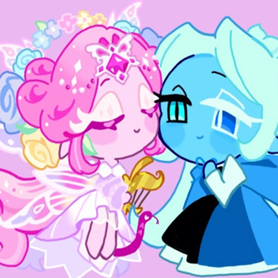
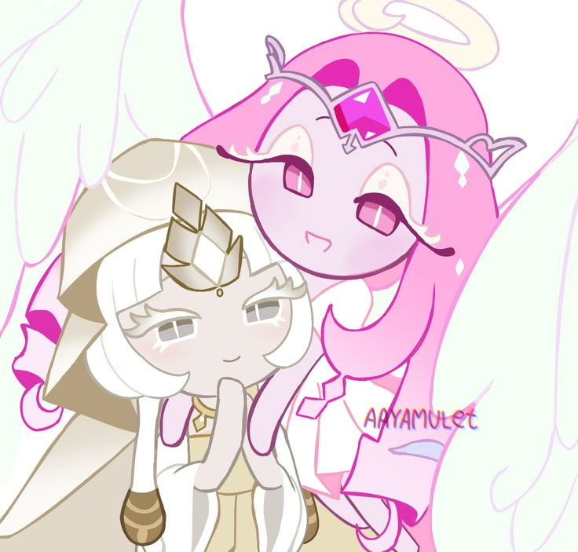
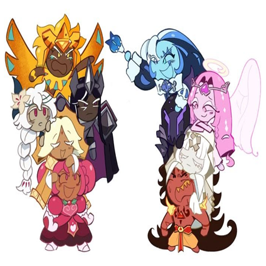
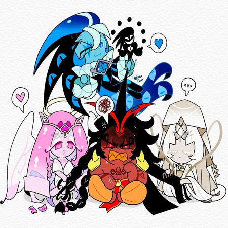

<table align="center">
  <tr>
    <td align="center" width="350">
      
    </td>
    <td align="center" width="350">
      
    </td>
  </tr>
  <tr>
    <td align="center" width="350">
      
    </td>
    <td align="center" width="350">
      
    </td>
  </tr>
</table>
<table align="center">
  <tr>
    <td align="center">
      
    </td>
    <td align="center">
      
    </td>
  </tr>
</table>
